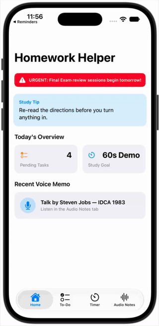

# Homework Helper Accessibility Remediation Challenge

## Illinois Team-Based Challenge Brief


### Client scenario

**Client:** A school district's Digital Learning and Accessibility Office, working with an educational technology partner.

**Business need:** Before Homework Helper is offered to all students, the client needs an accessibility compliance audit and a prioritized remediation plan. The team must evaluate the SwiftUI app against WCAG 2.2 AA-informed practices and Apple's accessibility guidance, then demonstrate and verify selected fixes.

**Driving question:** How can our team make Homework Helper more usable for students across Apple's accessibility categories — Vision, Hearing, Speech, Mobility, and General — while preserving the app's core study-planning experience?

This is an authentic workplace simulation: the client expects a clear report, evidence of testing, recommended code changes, and a concise presentation that supports a go/no-go rollout decision.

---

## Team Structure and Collaboration

Form teams of **3–4 students**. Assign one primary role per student; all team members contribute to the final audit, remediation decisions, and presentation.

| Role | Primary responsibilities | Evidence |
|---|---|---|
| Team Lead & Project Manager | Coordinates scope, meeting notes, issue-log ownership, synthesis, deadlines, and employability reflection. | Team plan, meeting notes, completed issue log. |
| Vision Specialist | Tests VoiceOver labels, values, traits, hints, and reading order; Dynamic Type, contrast, color independence, and Display & Motion settings (flashing, Reduce Motion). | VoiceOver test notes, screenshots, measurements, and Inspector findings. |
| Hearing, Speech & Mobility Specialist | Tests captions/transcripts and visual or haptic alternatives to audio (Hearing); confirms actions don't require the user to speak and considers Vocal Shortcuts/Live Speech opportunities (Speech); tests touch targets, gesture alternatives, and Switch Control/Voice Control reachability (Mobility). | Audio alternative notes, touch-target measurements, and Inspector findings. |
| SwiftUI Remediation & Verification Engineer | Traces root causes in `ContentView.swift`, implements approved fixes, and runs automated/manual verification. | Patch or pull request, XCTest/Inspector results. |

### Collaboration protocol

- Maintain one shared issue log with: issue ID, screen/feature, accessibility category, reproduction steps, user impact, severity, owner, proposed fix, verification result, and mentor feedback.
- Hold a short stand-up at the start of each work session: completed work, next work, and blockers.
- Use peer review before a finding is included in the final report; a second team member must reproduce it.
- Record every mentor recommendation and state whether the team adopted, adapted, or deferred it with a reason.
- Use respectful, professional language that centers the user impact rather than blaming a person or a disability.

-
## Challenge Workflow

### Phase 1 — Team Formation and Discovery Audit

1. Review the client scenario, create a team charter, assign roles, and meet the mentor at kickoff.
2. Complete a feature walkthrough and run an initial Accessibility Inspector audit.
3. Audit each screen using the five accessibility categories below.
4. Create a shared, evidence-based issue log and select the highest-impact findings for review.

**Phase deliverable:** Team charter, initial audit log, and mentor questions.

### Phase 2 — Root-Cause Analysis and Remediation Plan

1. Reproduce and prioritize findings by user impact, severity, frequency, and feasibility.
2. Trace selected findings to their likely SwiftUI implementation in `ContentView.swift`.
3. Propose code-level fixes and acceptance criteria; identify any tradeoffs or remaining risk.
4. Present the plan at the mentor design review and revise it from feedback.

**Phase deliverable:** Prioritized remediation plan with root cause, proposed fix, acceptance criteria, and mentor-feedback response.

### Phase 3 — Code Remediation and Verification

1. Implement the approved fixes in a branch or patch.
2. Re-test the affected screen with VoiceOver, Dynamic Type, audio/caption alternatives, touch-target and gesture accommodations, muted audio, and Reduce Motion as applicable.
3. Run the Accessibility Inspector audit and an automated XCTest accessibility audit where available.
4. Have a teammate independently verify each resolved issue.

**Phase deliverable:** Remediated code/pull request or patch, before-and-after evidence, and verification record.

### Phase 4 — Executive Report and Client Presentation

1. Prepare a concise Accessibility Audit Report for the client.
2. Deliver a 5–8 minute presentation and live demonstration to the mentor/client panel.
3. Explain resolved issues, deferred risks, verification results, and the recommendation for rollout.
4. Complete an individual reflection on technical growth and Essential Employability Skills.

**Phase deliverable:** Final report, presentation, demonstration, issue log, and individual reflection.

---

## Required Final Deliverables

1. **Accessibility Audit Report** — executive summary; audit scope; prioritized findings; affected users; screenshots or Inspector evidence; standards/guidance consulted; recommended actions; and residual risk.
2. **Remediation Artifact** — a pull request, patch, or clearly documented code changes for the selected fixes in `ContentView.swift`.
3. **Verification Evidence** — Accessibility Inspector results, manual test notes, and XCTest accessibility-audit results when the project has a UI-test target.
4. **Industry Presentation** — client-ready slides or briefing with a live demonstration, mentor feedback response, and rollout recommendation.

---
## Accessibility Categories

Apple groups its accessibility features into five categories. Use them to organize the audit instead of ad hoc labels.

| Category | Focus area | Audit questions |
|---|---|---|
| Vision | Blind, low-vision, or color-blind users — screen readers (VoiceOver), magnification, text size, color filters, invert colors, and motion cues | Can VoiceOver convey all information and actions? Does text scale with Dynamic Type? Is information distinguishable without color, with sufficient contrast? Is flashing/motion reduced when Reduce Motion is on? |
| Hearing | Users who are deaf, hard of hearing, or want audio support — captions, subtitles, and sound alerts | Do audio cues have captions, a transcript, or a visual/haptic alternative? Are alerts perceptible while the device is muted? |
| Speech | Users who cannot speak or prefer not to use verbal communication — Live Speech, Personal Voice, Vocal Shortcuts | Can every action be completed without requiring the user to speak aloud? Where the app could offer a spoken shortcut, is a typed or visual alternative still available? |
| Mobility | Hands-free and adaptive navigation for physical or motor disabilities — Voice Control, Switch Control, AssistiveTouch, touch accommodations | Are touch targets at least 44×44 pt? Can actions be completed without complex or multi-step gestures? Is the UI reachable by Switch Control and Voice Control? |
| General | Tools that simplify the experience, focus, and comprehension — Assistive Access, Guided Access, Focus, reduced distractions | Is the UI predictable? Are errors written in plain language? Are destructive actions confirmed or reversible? Are distractions minimized? |

---

## Accessibility Tools and Technical Reference

### Accessibility Inspector

Use **Xcode → Open Developer Tool → Accessibility Inspector** to inspect a running Simulator or device app.

- Run **Audit** for common issues such as missing labels, contrast, hit targets, and Dynamic Type.
- Inspect each control's **Label**, **Value**, **Traits**, and **Hint**.
- Test with simulated settings including Invert Colors, Dynamic Type, Reduce Motion, Differentiate Without Color, and Bold Text.

### Device and Simulator Tests

- **VoiceOver (Vision):** Navigate with swipe left/right and activate with double-tap. Confirm controls announce meaningful labels, state, and actions.
- **Dynamic Type (Vision):** Enable Larger Accessibility Sizes and test at the maximum size for clipping, overlap, and usable reading order.
- **Color and contrast (Vision):** Enable Differentiate Without Color and Increase Contrast; confirm status is not color-only.
- **Reduce Motion (Vision):** Enable it and confirm nonessential motion and flashing are reduced or removed.
- **Audio alternatives (Hearing):** Mute the device and verify that important audio alerts and recordings have a captioned or visual equivalent.
- **Spoken input (Speech):** Confirm no action requires the user to speak, and that any voice-driven shortcut has a typed or tapped equivalent.
- **Touch and gesture access (Mobility):** Evaluate target dimensions against the 44×44 pt Apple guidance and test Switch Control, Voice Control, or AssistiveTouch.
- **Predictability and errors (General):** Confirm error messages are plain-language and destructive actions are confirmed or reversible.

### XCTest accessibility audit

When a UI-test target is available, use an automated audit alongside manual testing:

```swift
func testAccessibilityAudit() throws {
    let app = XCUIApplication()
    app.launch()

    try app.performAccessibilityAudit()
}
```

Audits can be narrowed to categories such as `.contrast`, `.hitRegion`, `.dynamicType`, and `.elementDetection`.

### SwiftUI APIs to consider

| API / modifier | Purpose |
|---|---|
| `.accessibilityLabel(...)` | Gives a screen reader a meaningful description when visible text is absent or unclear. |
| `.accessibilityValue(...)` | Communicates a control's current state or value. |
| `.accessibilityHint(...)` | Explains the result of an interaction. |
| `.accessibilityAddTraits(...)` / `.accessibilityRemoveTraits(...)` | Corrects the semantic traits announced for an element. |
| `.accessibilityHidden(...)` | Removes decorative content from the accessibility tree. |
| `.accessibilityElement(children:)` | Combines or controls child semantics. |
| `.accessibilityAction(...)` | Adds a VoiceOver rotor action. |
| `@Environment(\\.accessibilityReduceMotion)` | Adapts custom animation to the user's Reduce Motion preference. |
| `@Environment(\\.dynamicTypeSize)` | Allows layouts to respond to the user's text-size preference. |

---

## Reference Resources

- [ISBE College and Career Pathway Endorsement: Team-Based Challenges and competency resources](https://www.isbe.net/pathwayendorsements)
- [ISBE Team-Based Challenge Step-by-Step Process](https://www.isbe.net/Documents/Career-Awareness-Career-Exp.pdf)
- [Apple Accessibility (overview of Vision, Hearing, Speech, Mobility, and General features)](https://www.apple.com/accessibility/)
- [Apple Human Interface Guidelines: Accessibility](https://developer.apple.com/design/human-interface-guidelines/accessibility)
- [Apple Accessibility developer documentation](https://developer.apple.com/accessibility/)
- [W3C Web Content Accessibility Guidelines (WCAG) 2.2](https://www.w3.org/TR/WCAG22/)
